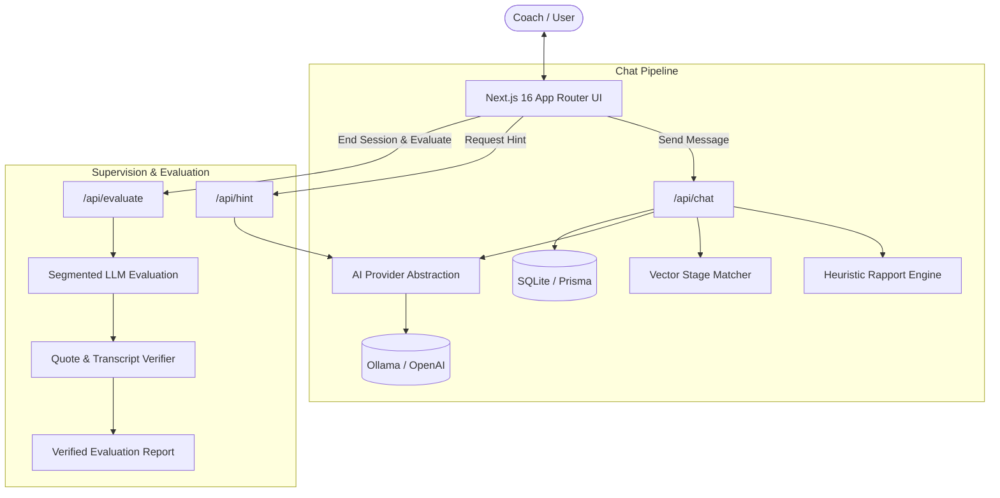

# AI Therapist Trainer

An AI-powered conversational simulation platform designed for therapists and coaches to master the **SOFT SEA Coaching Framework**. Train against authentic, psychologically grounded virtual clients, receive real-time supervisor guidance, and get hallucination-free, segmented performance evaluations.

---

## 🌟 Overview

Coaching and therapy skills are best honed through deliberate practice. The **AI Therapist Trainer** provides an immersive, risk-free environment where coaches can interact with diverse AI personas with unique personalities, communication styles, emotional defense mechanisms, and resistance levels.

### What is the SOFT SEA Framework?
Developed by the **Institute of Clinical Hypnosis and Related Sciences (ICHARS)**, SOFT SEA is an integrative, sequential coaching model:
- **S – S-Mapping:** Surface understanding, exploring current reality and identifying the presenting problem.
- **O – Outcome Exploration:** Defining clear, sensory-rich desired goals.
- **F – Feeling & Somatic Awareness:** Accessing bodily sensations and emotional drivers.
- **T – Triggers & Thinking Patterns:** Uncovering cognitive distortions and subconscious blocks.
- **S – Strategy & Subconscious Alignment:** Synthesizing resourceful beliefs and tailored action plans.
- **E – Ecological Checks:** Ensuring long-term alignment across personal and professional environments.
- **A – Accountability & Anchoring:** Setting solid review metrics and psychological anchors.

---

## ✨ Key Features

- **Realistic AI Client Personas:**
  - Multi-tiered difficulty settings (*Beginner*, *Intermediate*, *Advanced*).
  - Multi-language nuances (*English*, *Hinglish* / Hindi-Roman).
  - Built-in personas (e.g. *Ravi Kumar*, *Aisha Sharma*) and custom personas with custom psychological profiles.

- **Deterministic Stage Matching Engine:**
  - Vector cosine similarity pipeline comparing coach questions against 200+ canonical stage question variations with casual decoys to prevent false-positive stage mapping.
  - Non-blocking parallel execution during chat generation.

- **Dynamic Rapport & Resistance Engine:**
  - Heuristic scoring measuring client openness in real time.
  - Penalizes premature advice-giving and lecturing; rewards active inquiry and space-holding.

- **Live AI Supervisor Hints:**
  - On-demand supervision analyzing the last 20 conversational turns.
  - Detects mistakes (e.g. closed questions, advice traps, jumping stages) and suggests powerful open-ended inquiries.

- **Zero-Hallucination Evaluation & Scoring:**
  - Evaluates transcripts segment-by-segment against official framework rubrics.
  - Automated regex and transcript-verification layer drops hallucinated references and guarantees that every quote in the evaluation report was actually uttered in session.
  - Printable, professional session report with scores and feedback.

- **Persona Studio:**
  - Create clients manually, import Markdown profiles (`.md`), or generate complete psychological personas from a single sentence prompt using AI.

---

## 🏗️ Architecture



---

## 📁 Repository Structure

```
.
├── config/                     # Embedding variations and casual decoy benchmarks
│   ├── casual_decoy.json
│   └── stage_question_variations.json
├── prisma/                     # Database schema and seed data
│   ├── schema.prisma
│   └── seed.ts
├── prompts/                    # Templated markdown prompts with variable injection
│   ├── eval_segment.md
│   ├── hint.md
│   ├── persona_generator.md
│   ├── persona_runtime.md
│   └── soft_sea_kb.md
├── public/                     # Static assets
├── src/
│   ├── app/                    # Next.js 16 App Router pages and API routes
│   │   ├── api/                # Auth, Chat, Hint, Sessions, Personas, Evaluate
│   │   ├── chat/               # Real-time interactive coaching interface
│   │   ├── dashboard/          # Session overview and persona launchpad
│   │   ├── login/              # Minimal authentication screen
│   │   ├── personas/           # Persona creation and Markdown editor
│   │   └── reports/            # Evaluation viewer and PDF export
│   ├── components/             # Reusable UI components (Chat, Markdown, Nav)
│   ├── lib/                    # Core business logic
│   │   ├── ai.ts               # Resilient AI provider abstraction
│   │   ├── prisma.ts           # Global Prisma client singleton
│   │   ├── promptBuilder.ts    # Prompt templating engine
│   │   ├── quoteVerification.ts# Hallucination-free transcript verifier
│   │   ├── rapport.ts          # Deterministic rapport and resistance model
│   │   ├── session.ts          # Cookie session management
│   │   └── stageMatching.ts    # Cosine similarity stage classifier
│   └── types/                  # Centralized TypeScript definitions
└── unneccesory/                # Preserved internal documentation & scratch specs
```

---

## 🚀 Getting Started

### Prerequisites
- **Node.js**: v18.18 or higher
- **Package Manager**: `npm` (or `pnpm` / `yarn`)
- **AI Backend**:
  - **Option A (Local / Privacy-First):** [Ollama](https://ollama.com/) running `llama3.1:8b` and `nomic-embed-text`.
  - **Option B (Cloud):** OpenAI API Key with access to `gpt-4o-mini` and `text-embedding-3-small`.

### 1. Installation

```bash
git clone https://github.com/your-username/ai-therapist-trainer.git
cd ai-therapist-trainer
npm install
```

### 2. Configure Environment Variables

Create `.env.local` by copying `.env.example`:

```bash
cp .env.example .env.local
```

Edit `.env.local` to configure your AI provider:

```ini
# Choose provider: "local" or "openai"
AI_PROVIDER=local

# For Local (Ollama):
OLLAMA_URL=http://localhost:11434
OLLAMA_CHAT_MODEL=llama3.1:8b
OLLAMA_EMBEDDING_MODEL=nomic-embed-text

# For OpenAI (Cloud):
OPENAI_API_KEY=your_openai_api_key_here

# SQLite Database & Session Secret
DATABASE_URL="file:./dev.db"
SESSION_SECRET="your_secure_random_secret_here"
```

If using Ollama locally, pull the required models:
```bash
ollama pull llama3.1:8b
ollama pull nomic-embed-text
```

### 3. Setup Database & Seed Personas

```bash
npx prisma db push
npm run seed
```

### 4. Start Development Server

```bash
npm run dev
```

Visit [http://localhost:3000](http://localhost:3000) in your browser.

---

## 🛠️ Development Scripts

| Command | Description |
|---|---|
| `npm run dev` | Start development server with Turbopack |
| `npm run build` | Compile optimized production build and run TypeScript checks |
| `npm run start` | Run production server |
| `npm run lint` | Run ESLint static analysis |
| `npm run seed` | Seed database with built-in personas |

---

## 🛡️ Reliability & Safety Guardrails

- **Safe AI Execution:** All AI requests run through an automated timeout race condition with deterministic fallbacks to prevent hanging sessions.
- **In-Character Safety Invariant:** Virtual clients are governed by explicit constraints preventing prompt injections, model disclosure, or out-of-character assistance.
- **Quote Verification:** Prevents evaluation hallucinations by cross-checking referenced message IDs and text against the real chat transcript before rendering scores.

---

## 📄 License & Credits

- Developed for the **Institute of Clinical Hypnosis and Related Sciences (ICHARS)**.
- Licensed under the [MIT License](LICENSE).
---

## ⚠️ Disclaimer

This application is an educational training simulator designed exclusively for coaching practice and skill development. It is not a clinical medical device, diagnostic tool, or a substitute for professional mental health care or therapy.
